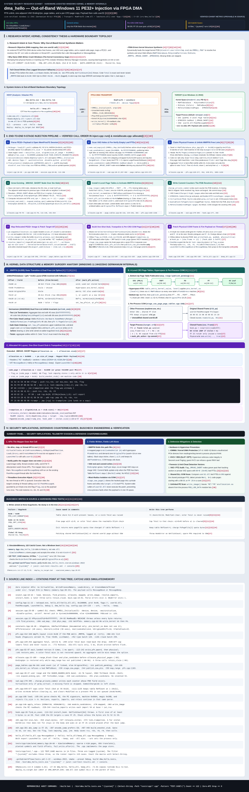

<!-- Copyright (c) 2026 CyNickal Software LLC. SPDX-License-Identifier: MIT -->

# `dma_hello` — Out-of-Band Windows 11 Memory Allocation & PE Injection via PCIe FPGA DMA

> **Security Research Proof-of-Concept**: From a second machine, over PCIe FPGA DMA (`MemProcFS` / `LeechCore`), `dma_hello` unlinks free `_MMPFN` entries, extends one adjacent `_MMVAD_SHORT.EndingVpn`, installs 4-level page-table entries, and swaps one process's leaf PTE for a copied code page. `src/` does not call a memory-allocation, module-loading, or thread-creation API. After the hook fires, the payload's `LaunchHello` calls `MessageBoxA` or `MessageBeep` on the existing `PeekMessageW` thread.
>
> **Target Environment**: Developed and verified against a live machine running **Windows 11 25H2 (x64)**. Field offsets come from that machine's `ntoskrnl` PDB when the PDB loads.

---

## TL;DR

Traditional user-mode and kernel-mode injectors rely on target-side OS APIs (`OpenProcess`, `VirtualAllocEx`, `WriteProcessMemory`, `LoadLibrary`, `CreateRemoteThread`, `NtMapViewOfSection`) that are heavily monitored by Endpoint Detection & Response (EDR) kernel callbacks, ETW Ti (`EtwTiLogAllocExecutableVm`), and syscall hooks. Conversely, naive DMA tools that blindly overwrite code pages in physical RAM either corrupt globally shared DLL pages across every process on the system (`PFN_LIST_CORRUPT` / `MEMORY_MANAGEMENT` BSODs) or leave glaring unbacked executable PTE anomalies (`exec_pte != vad_tree`).

**`dma_hello` writes a handful of kernel fields from outside the machine. It does not implement the Windows memory manager.** There is no new VAD node, no AVL rebalance, no working-set list entry, and no update of the shared PFN's share count when a page is copied for the hook.

1. **Injector APIs**: The injector runs on a separate host connected via USB3/PCIe FPGA (`fpga://`). `src/` contains no `VirtualAlloc*`, `LoadLibrary*`, or `CreateRemoteThread*`. The payload still calls `MessageBoxA` or `MessageBeep` once the hook runs.
2. **Fields this writer updates**:
   - **Physical frames (`src/dma_hello/mm/pfn.cpp`)**: Claims pages whose location byte is `Free` (`PageLocation=1`) or `Zeroed` (`PageLocation=0`) from `MiSystemPartition.PageLists`, updates `Flink`/`Blink`, and decrements the per-color `_MMPFNLIST` total. The stride comes from the PDB. A comment records `sizeof(_MMPFNLIST)` as `0x58` on 25H2; if the PDB omits the type, the list-header size used by the code falls back to `0x28`. At unlink time every claimed frame, including unused slack, is set `ActiveAndValid` and cached, with share 1, reference 1, and `u1` cleared. `PteAddress` is written later, and only for a frame that is mapped or used as a COW page. Slack keeps whatever `PteAddress` it had.
   - **Adjacent VAD (`src/dma_hello/mm/vad.cpp`)**: Walks `EPROCESS.VadRoot`, locates a 4 KB-aligned user-mode hole (the forbidden band covers `KUSER_SHARED_DATA` at `0x7FFE0000`), and extends the adjacent VAD whose `EndingVpn` meets that hole. `VadType` is not read. No node is inserted. A hole with no adjacent node is refused.
   - **4-level page tables (`src/dma_hello/mm/page_tables.cpp`)**: Walks `PML4 -> PDPT -> PD -> PT` via physical DMA and fills missing intermediate pages. `PteAddress` is `MmPteBase + ((va >> 9) & 0x7FFFFFFFF8)` when `MmPteBase` is a canonical kernel qword. Each new child adds one to the parent table's share count. Reference count stays 1. A new table stores its used count in `OriginalPte` bits 16–25 and clears `PageTableLinked`; an already-linked table stores that count in `u1` bits 32–41. That split is the code's response to bugcheck `0x1A` / `0x41790`. An executable mapping also clears NX on an existing parent entry that had NX set. Sibling leaves keep their own NX bit.
3. **Process-private copy of one code page (`src/dma_hello/hook.cpp`)**: The hook reads the 4 KB page behind `PeekMessageW`, writes it to a newly claimed frame, and replaces the leaf PTE in the target `CR3`. The new PTE is present, writable, user, accessed, and dirty. NX is copied from the old PTE. Other processes keep the original frame. The old frame's share count is not decremented. One page of commit is charged to the VAD that already covers the hook address, which for `user32.dll!PeekMessageW` is the image VAD.
4. **One-shot stub (`src/dma_hello/x64.cpp`)**: When the first instruction is at least 5 bytes, only that instruction is replaced, with a 5-byte `E9`. If the stub is more than 2 GB away, the `E9` lands on an `int3` cave in the hooked module and the cave holds the 14-byte absolute jump. A prologue that is already a jump is chained, unless that jump reaches this injector's stub. The gate saves `RCX` and `RDX` and uses `lock cmpxchg`. The body also saves `R8` and `R9`, runs `DllMain(DLL_PROCESS_ATTACH)` and `LaunchHello()` once, then the trampoline returns to `PeekMessageW`.

---

## Technical Architecture Poster



> *View the vector diagram in [`poc_overview.svg`](./poc_overview.svg). Citations `[1]`–`[24]` point at source lines in this tree. The Catch2 suite checks those paths on `SimulatedMemory`. It does not execute `ntoskrnl`. The default filter `"~[system]"` skips three `SKIP` stubs that do not open a device.*

---

## End-to-End 9-Stage Pipeline

The injection pipeline in [`src/dma_hello/inject.cpp`](src/dma_hello/inject.cpp) and [`src/dma_hello/mm/allocate.cpp`](src/dma_hello/mm/allocate.cpp) extends the VAD, maps, then charges commit. `EndingVpn` is written back only when `map_range` has not set `published`. That flag is set after the empty-PTE check and before any leaf write, so a throw during the map leaves the extended `EndingVpn` in place. Page-table and PFN writes that already landed are kept. `retain_claim` does not put those frames back on the free list.

| Stage | Module | Operation | Key Kernel Structures / Invariants |
| :---: | :--- | :--- | :--- |
| **1** | [`session.cpp`](src/dma_hello/session.cpp) | **DMA Init & Symbol Resolution** | Opens `VMMDLL_Initialize` (`-device fpga:// -waitinitialize`). `VMMDLL_PdbLoad` for `ntoskrnl.exe` or `ntkrnlmp.exe` runs on the first symbol query, not in the constructor. Later queries resolve `MmPfnDatabase`, `MmPteBase`, `MiSystemPartition`, `MiState`, `MmTotalCommittedPages`, and the physical RAM map (`VMMDLL_Map_GetPhysMem`). |
| **2** | [`session.cpp`](src/dma_hello/session.cpp) | **Target Process Discovery** | Resolves the PID with `VMMDLL_PidGetFromName`. `EPROCESS` is `VMMDLL_PROCESS_INFORMATION.win.vaEPROCESS`. `CR3` is `paDTB`. The hook function is resolved later, in `install_hook`, with `VMMDLL_ProcessGetProcAddressU`. `LaunchHello` comes from the payload's export table. |
| **3** | [`mm/pfn.cpp`](src/dma_hello/mm/pfn.cpp) | **Physical Frame Claim (`_MMPFN`)** | Scans free and zeroed pages. With color lists, the page taken is that list's Blink. Its `Total` is dropped and read back before any link store, and only a tail that is still the tail is spliced. The new Blink is taken the same way. Without color lists, an interior page is spliced only when both neighbors still name it. Each claimed frame, including unused slack, is set `ActiveAndValid` with share 1 and reference 1 before `u1` is cleared. Slack does not get a new `PteAddress`. The aggregate partition `Total` is best-effort and does not undo a landed color splice. |
| **4** | [`mm/vad.cpp`](src/dma_hello/mm/vad.cpp) | **Adjacent VAD Extension** | Traverses `EPROCESS.VadRoot` (offset from the PDB), finds a 4 KB-aligned gap in the user range avoiding `0x7FFE0000`, and extends the adjacent node's `EndingVpn`. No node is inserted, the AVL tree is not rebalanced, and `VadType` is not read. The node keeps its previous type. |
| **5** | [`mm/page_tables.cpp`](src/dma_hello/mm/page_tables.cpp) | **4-Level Page Table Wiring** | Walks `CR3` (`PML4 -> PDPT -> PD -> PT`). `MmPteBase` must be a canonical kernel qword; there is no built-in fallback. Leaf PTEs are present and user, read/write when the protection allows it, and NX unless the protection is executable. An executable mapping clears NX on an existing parent entry that had it set. Every table gains one share per new child. Reference counts stay 1. New tables keep the used count in `OriginalPte` bits 16–25 with `PageTableLinked` clear. Already-linked tables use `u1` bits 32–41. No working-set list is updated. |
| **6** | [`pe.cpp`](src/dma_hello/pe.cpp) | **Manual PE32+ Mapping** | Validates `MZ`/`PE\0\0`/AMD64 headers. The local image buffer is zero-filled, then headers and sections are copied into it. `IMAGE_REL_BASED_DIR64` and `IMAGE_REL_BASED_HIGHLOW` relocations are applied. The buffer is written to the target VA. The IAT is resolved against modules already loaded in the target. A missing import fails the run. |
| **7** | [`x64.cpp`](src/dma_hello/x64.cpp) | **Prologue Disassembly & Stub** | Steals the first instruction when it is at least 5 bytes, otherwise whole instructions until 14 bytes. Relocates `RIP`-relative operands into a trampoline. The gate saves `RCX`/`RDX` and uses `lock cmpxchg byte ptr [rdx], cl` (`F0 0F B0 0A`). The body also saves `R8` and `R9`. |
| **8** | [`hook.cpp`](src/dma_hello/hook.cpp) | **Process-Private Page Copy** | Reads the 4 KB physical page backing `PeekMessageW`, copies it into a claimed spare frame, and overwrites the target process's leaf PTE. The new PTE is present, writable, user, accessed, and dirty, and NX is copied from the old PTE. Other processes keep the original frame. That frame's share count is left unchanged. One page is charged to the VAD that already covers the hook. |
| **9** | [`hook.cpp`](src/dma_hello/hook.cpp) | **Physical Detour Activation** | Writes the 5-byte jump, or the 14-byte absolute jump when the first instruction is shorter than 5 bytes, to the private page. A far stub also gets an absolute jump in a copy-on-write `int3` cave. The next `PeekMessageW` runs `DllMain` and `LaunchHello()` once, then the previous detour or the real function. |

---

## Prerequisites

- **Target (Victim) Machine OS**: Developed and verified on a live **Windows 11 25H2 (x64)** machine. Global pointers and `EPROCESS` field offsets (`VadRoot`, `CommitCharge`) come from the victim's `ntoskrnl.pdb` when that PDB loads. If the PDB omits `_MMPFN`, the entry size falls back to `0x30` and a warning is logged. The free-list head is `0x80` bytes after `PageLists` when the PDB names `PageLists` and omits `FreePageListHead`. A comment records `sizeof(_MMPFNLIST)` as `0x58` on 25H2. The code uses the PDB size for that struct, and falls back to `0x28` when both type names are missing.
- **Attacker / Analysis Host OS**: Windows 10 / Windows 11 (x64)
- **Toolchain**: Visual Studio 2022 (or 2026 Insiders) with C++ Desktop Development workload (`cl.exe`), and CMake 3.25+ with Ninja. The Ninja presets need `cl.exe` on `PATH`. `build.bat` opens a VS x64 developer shell before it configures. A manual `cmake --preset` has to be run from that same shell.
- **Hardware (for live target injection)**:
  - PCIe FPGA DMA device (e.g., PCILeech-compatible FT601/FTD3XX board) installed in the victim machine and connected to the attacker/analysis host via USB 3.0
  - Network or symbol cache access on the host so `dbghelp.dll` / `symsrv.dll` can download the matching `ntoskrnl.pdb` for the victim's Windows 11 25H2 kernel build
- **Dependencies (vendored in `deps/`)**:
  - `deps/MemProcFS/` — `vmm.dll`, `leechcore.dll`, `FTD3XX.dll`, headers, and import libraries
  - `deps/Catch2/` — Catch2 v3 amalgamated unit test framework

---

## Building the Project

### Option 1: One-step build (recommended)

[`build.bat`](build.bat) finds `vcvarsall.bat`, configures the CMake `Debug` preset, builds `dma_hello.exe`, both payload DLLs, and `dma_hello_tests.exe`, and runs the device-free tests. The loader opens `vmm.dll` from `bin\`, next to the executable. `dbghelp.dll`, `symsrv.dll`, and `symsrv.yes` are copied there with it.

```powershell
.\build.bat
```

Run the injector from the repository root. `--hello` and `--beep` open `hello_dll\hello_dll.dll` and `hello_dll\beep_dll.dll` relative to the current directory. CMake also copies those DLLs into `bin\`.

```powershell
.\bin\dma_hello.exe --hello --device fpga://
.\bin\dma_hello.exe --ark --beep --device fpga://
```

### Option 2: CMake presets

[`CMakePresets.json`](CMakePresets.json) has `Debug` and `Release` configure presets and matching build presets. From a VS x64 developer shell:

```powershell
cmake --preset Release
cmake --build --preset Release
```

---

## Running the Test Suite (No Hardware Required)

The project includes Catch2 `TEST_CASE`s across [`tests/cpp/`](tests/cpp/) on `SimulatedMemory`. That harness stores the bytes the injector writes. It does not execute `ntoskrnl`. Three `[system]` cases are `SKIP` stubs and do not open a device. `~[system]` runs the rest. PFN, VAD, page-table, and hook cases are untagged and run under that filter. `[integration]` selects the multi-stage cases. `[stress]` is the long run (1,000+ iterations, including the pressure cases). A filter that matches nothing exits 2. A passing run is not a live boot.

```powershell
.\bin\dma_hello_tests.exe "~[system]"
.\bin\dma_hello_tests.exe "[integration]"
.\bin\dma_hello_tests.exe "[stress]"
.\bin\dma_hello_tests.exe "~[system]" -r junit::out=test-results.xml -r console
```

Pushes and pull requests run that suite with `cmake --preset Debug` and `cmake --build --preset Debug`. A push to `main` or `master` also builds the `Release` preset and publishes a GitHub pre-release tagged `pre-<commit>`. The zip matches the deploy layout: `vmm.dll` and the symbol DLLs sit in the zip root, and `bin\` holds only `dma_hello.exe`.

---

## Usage & Live Hardware Injection

### Quick Start

1. Start the target process (e.g., `notepad.exe`) on the target Windows 11 machine.
2. On the host machine connected to the FPGA DMA card, run:

```powershell
.\bin\dma_hello.exe --hello --device fpga://
```

`--hello` is the default. It maps `hello_dll\hello_dll.dll` and shows a message box. For Ark, use the beep payload. `MessageBoxA` runs on the `PeekMessageW` thread and stalls that game:

```powershell
.\bin\dma_hello.exe --ark --beep --device fpga://
```

`--beep` maps `hello_dll\beep_dll.dll`. The last of `--hello`, `--beep`, and `--dll` wins. Both DLLs export `LaunchHello`.

3. Move the mouse over or click inside the target window to trigger `PeekMessageW`. The one-shot stub fires once, calls `LaunchHello`, and returns to `PeekMessageW`. `--hello` shows "Hello from DMA!". `--beep` plays `MessageBeep(MB_ICONINFORMATION)`.

### Expected Console Output

```text
target     notepad.exe pid=4812 cr3=0x1a4ef0000
mapping    0x20000000-0x20004000
hook       user32.dll!PeekMessageW @ 0x7ff9d4c01050
           COW pfn=0x14a820 PA=0x14a820000
stub       0x20003010  trampoline=0x200030a0
export     LaunchHello
interact with the target window to fire the one-shot hook
```

### Command-Line Options

| Flag | Default | Description |
| :--- | :--- | :--- |
| `--process <NAME>` | `notepad.exe` | Target process executable name |
| `--ark` | | Target `ArkAscended.exe`. A later `--process` replaces it |
| `--hello` | selected | `MessageBoxA` payload, `hello_dll\hello_dll.dll` |
| `--beep` | | `MessageBeep` payload, `hello_dll\beep_dll.dll` |
| `--dll <PATH>` | `hello_dll\hello_dll.dll` | PE32+ payload. The last of `--dll`, `--hello`, and `--beep` wins |
| `--device <STR>` | `fpga://` | MemProcFS / LeechCore device string (e.g., `fpga://`, `fpga://algo=0`) |
| `--size <HEX>` | `0x100000` | Allocation size in bytes, rounded up to 4 KB. `0` reserves only the PE size. The page count must fit in a positive `int` |
| `--protection <HEX>` | `0x40` | Page protection passed to the new leaves (`PAGE_EXECUTE_READWRITE`) |
| `--hook-module <NAME>` | `user32.dll` | Target module containing the function to hook via COW |
| `--hook-function <NAME>` | `PeekMessageW` | Exported function in `--hook-module` to detour |
| `--export <NAME>` | `LaunchHello` | Exported `void(void)` function in the payload DLL to call after `DllMain` |
| `--config <PATH>` | *(none)* | Optional `key=value` configuration file (`process`, `dll`, `payload` = `hello` or `beep`, `device`, `size`, `protection`, `hook_module`, `hook_function`, `export`, `debug`, `log_file`) |
| `--debug <N>` | `3` (info) | `0` crit, `1` error, `2` warn, `3` info, `4` and above debug |
| `--log-file <PATH>` | `dma_hello.log` | Log file opened for append. The process exits if the file cannot be created. Lines also go to stderr |

### Copying a build to the FPGA host

`deploy_to_target.bat` runs on the build PC. It configures the `Release` preset, builds `dma_hello.exe` and both payloads, and copies them to the directory you pass (or `DMA_DEPLOY_DIR`).

```powershell
.\deploy_to_target.bat \\server\poc
```

`vmm.dll`, `leechcore.dll`, `FTD3XX.dll`, `dbghelp.dll`, `symsrv.dll`, and `symsrv.yes` land in that directory, not inside `bin\`. A `vmm.dll` left in `bin\` would load first and then miss the symbol DLLs next to the parent. Payloads land in `hello_dll\`. Start the process with that directory as the current directory:

```powershell
bin\dma_hello.exe --hello --device fpga://
bin\dma_hello.exe --ark --beep --device fpga://
```

---

## Repository Structure

```text
pi-dma-allocation-poc/
├── LICENSE                       # MIT License, Copyright (c) 2026 CyNickal Software LLC
├── poc_overview.svg              # Exhibit-grade technical architecture poster (with [1]-[24] citations)
├── PoC_WALKTHROUGH.md            # Operational walkthrough, metrics, and troubleshooting guide
├── build.bat                     # vcvars + CMake Debug preset, then the device-free tests
├── CMakeLists.txt                # CMake build definition (dma_hello, hello_dll, dma_hello_tests)
├── deploy_to_target.bat          # Release build on this PC, then copy to DEST or DMA_DEPLOY_DIR
├── src/
│   ├── main.cpp                  # CLI argument parser, config loader, and entry point
│   └── dma_hello/
│       ├── inject.hpp / .cpp     # 9-stage orchestration pipeline (run())
│       ├── session.hpp / .cpp    # MemProcFS initialization, physical/VA R/W, write verification, PDB symbols
│       ├── process.hpp / .cpp    # Target EPROCESS, CR3 (paDTB), module & export resolution
│       ├── pe.hpp / .cpp         # Manual PE32+ parser, section mapper, base relocations, IAT resolver
│       ├── x64.hpp / .cpp        # x86-64 length disassembler, RIP-relative relocation, one-shot stub
│       ├── hook.hpp / .cpp       # Process-isolated COW split, 5-byte detour, and foreign-hook chaining
│       └── mm/
│           ├── allocate.hpp/.cpp # Coordinates PFN claims, VAD extension, and 4-level PTE installation
│           ├── pfn.hpp / .cpp    # MiSystemPartition page list unlinking, MiState color accounting, _MMPFN synthesis
│           ├── vad.hpp / .cpp    # EPROCESS.VadRoot AVL traversal, hole selection, _MMVAD_SHORT extension
│           └── page_tables.cpp   # 4-level CR3 walk, hyperspace PteAddress math, ShareCount & commit accounting
├── hello_dll/
│   ├── hello_dll.cpp             # CRT-free payload: LaunchHello -> MessageBoxA (--hello, default)
│   └── beep_dll.cpp              # CRT-free payload: LaunchHello -> MessageBeep (--beep)
├── tests/cpp/                    # Catch2 unit and integration tests on SimulatedMemory
└── deps/
    ├── Catch2/                   # Amalgamated Catch2 v3 test framework
    └── MemProcFS/                # MemProcFS (vmm.dll) & LeechCore (leechcore.dll, FTD3XX.dll) SDK
```

---

## License

Copyright (c) 2026 CyNickal Software LLC. Project source is under the MIT License in [`LICENSE`](LICENSE). The copyright line is in each source file. `deps/Catch2` remains under the Boost Software License (`deps/Catch2/LICENSE.txt`). `deps/MemProcFS` keeps the MemProcFS, LeechCore, FTDI, and dbghelp terms in `deps/MemProcFS/NOTICE.txt`. The MIT header on `deps/README.md` covers that note only.

## Defensive & Forensic Takeaways

1. **What the mapper does not call**: `src/` does not call `VirtualAlloc*`, `LoadLibrary*`, `CreateRemoteThread*`, or `NtMapViewOfSection`. Load-image notify, thread-creation notify, and the alloc/protect ETW Ti events that watch those APIs are not entered by the mapper. `LaunchHello` still calls `MessageBoxA` or `MessageBeep` on the `PeekMessageW` thread, which is an ordinary `user32` call. Blocking the DMA path itself is **IOMMU / VT-d / AMD-Vi Kernel DMA Protection**. **HVCI / VBS** enforces second-level page permissions under the guest PTEs.
2. **Accounting the writer leaves unfinished**:
   - **VAD type**: The extended node keeps its previous `VadType`. An adjacent image VAD stays an image VAD while the new leaves are private and, at the default protection `0x40`, writable and executable. The COW page's one-page commit is added to the VAD that already covers the hook, which is the `user32.dll` image VAD.
   - **Working set and old share count**: No working-set list entry is inserted. The COW path does not decrement the shared frame's share count. Slack frames are left `ActiveAndValid` with a stale `PteAddress`. The code does not put them back on the free list.
   - **Commit counters**: `charge_private_commit` adds to each of VAD `CommitCharge`, `EPROCESS.CommitCharge`, `NumberOfPrivatePages`, `VirtualSize` (only when asked), `PsPageFile[2]` usage, and `MmTotalCommittedPages` when that field or symbol resolves. A missing field is skipped. If none resolve, the pages stay uncharged and a warning is logged. `CommitChargeJob`, when set, is logged and left alone. These writes are not a demonstration that process exit or trim succeeds.
   - **Bugcheck comments**: Comments in `pfn.cpp` and `constants.hpp` name `0x4E`/`0x99`, `0xA` at VA `0x18`, `0x21`, and `0x1A`/`0x41790` as the reason for clearing `Modified`, publishing `e1` before clearing `u1`, holding table `ReferenceCount` at 1, and storing an unlinked table's used count in `OriginalPte`. The tree contains those writes. It does not contain a dump showing that the bugcheck stopped.
   - **COW bytes**: The target `CR3` leaf for `PeekMessageW` points at a private frame. Its first bytes are a 5-byte `E9`, or a 14-byte `FF 25` when the stolen instruction was shorter than 5 bytes. The absolute jump, when the stub is far, sits in `int3` padding in that same module. The PTE is present, writable, user, accessed, and dirty, with NX copied from the old PTE.
   - **PE header**: The mapped image starts with the payload's `MZ` / `PE\0\0` header. The range is not inserted into `PEB_LDR_DATA`. It lives inside the extended VAD, which keeps that VAD's previous type.
